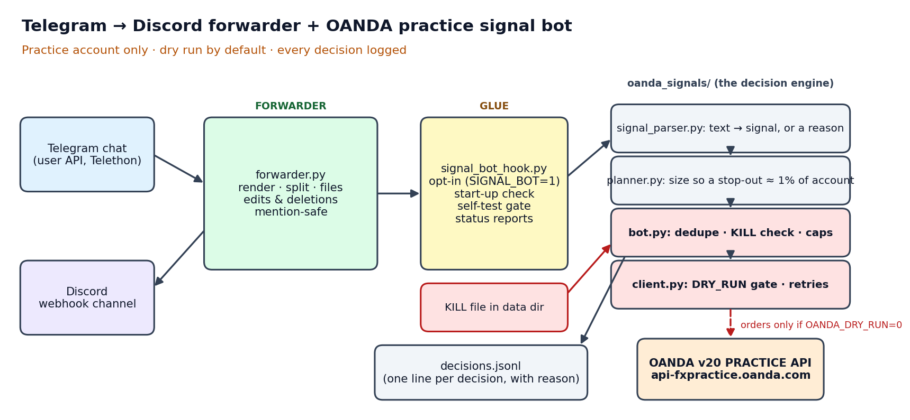

# Telegram → Discord forwarder + OANDA practice signal bot

A small always-on Python service that does two jobs:

1. **Forwards** messages from a Telegram chat into a Discord channel (text, photos, files, albums, replies, polls, edits and deletions).
2. **Optionally reads trade-signal messages** in that chat, turns each one into a sized order plan, and — only if explicitly switched on — places it on an **OANDA practice (demo) account**. By default it only *logs what it would have done*.



> ## ⚠️ Practice account only. Not a live trading service. Not financial advice.
> The OANDA client points at OANDA's **practice** address and contains **no code path to a live account**. It ships in **dry-run mode** and never places an order unless a human sets `OANDA_DRY_RUN=0`. Nothing here is a recommendation to trade, and no performance claims are made. All signal text in this repository is synthetic.

## What this project demonstrates

| Skill | Where to look |
|---|---|
| Integrating three external APIs (Telegram user API, Discord webhooks, OANDA v20 REST) | `forwarder.py`, `oanda_signals/client.py` |
| Defensive parsing of messy human text into validated data | `oanda_signals/signal_parser.py` |
| Pure, testable business logic separated from I/O | `oanda_signals/planner.py` (position sizing), `rules.py` (all limits in one file) |
| Operational safeguards (dry run, kill switch, risk caps, retries, audit log, start-up self-test) | see **Safeguards** below |
| Automated tests that run offline with fakes | `tests/` — 67 tests, no network |
| Secrets handled through environment variables only | `.env.example`, `render.yaml` |

## Architecture in one paragraph

`forwarder.py` logs in to Telegram as a user (Telethon), renders each message for Discord and posts it through a webhook, remembering the mapping so later edits and deletions can be mirrored. `signal_bot_hook.py` is the opt-in glue: for each new message it passes the text to `oanda_signals/`. There, `signal_parser.py` decides whether the text is a valid signal (or why not), `planner.py` computes an entry, stop, target and position size, and `bot.py` applies the guard rails (duplicate check, kill switch, daily risk cap, max open orders) before asking `client.py` to place a limit order. In dry run, `client.py` returns a fake `DRY-n` order id instead of calling OANDA. Every decision, including every skip and its reason, is appended to `decisions.jsonl`.

More detail and design decisions: [`docs/DESIGN.md`](docs/DESIGN.md).

## Safeguards (and exactly where they live)

| Safeguard | What it does | Code |
|---|---|---|
| **Practice endpoint only** | The base URL is a constant pointing at `api-fxpractice.oanda.com`; there is no setting or branch for a live host. | `oanda_signals/client.py` → `BASE` |
| **Dry run by default** | `dry_run` is on unless the environment variable is exactly `OANDA_DRY_RUN=0`. In dry run, `place_limit` and `cancel` return fake results and send nothing. | `client.py` → `Oanda.__init__`, `place_limit`, `cancel` |
| **Opt-in bot** | The whole signal bot is off unless `SIGNAL_BOT=1`. Forwarding works without it, and a bot error never stops forwarding. | `signal_bot_hook.py` |
| **Kill switch** | If a file named `KILL` exists in the data directory, every new signal is skipped and logged with the reason. No restart or redeploy needed. | `oanda_signals/bot.py` → `_on_signal` |
| **Risk controls** | Size so a stop-out loses ≈ 1 % of the account; at most 3 % total risk per day; at most 5 open/pending orders; never use more than 80 % of free margin; unfilled orders expire after 4 h. | `oanda_signals/rules.py` (the numbers), `planner.py` (sizing), `bot.py` (caps) |
| **Stale-message guard** | Messages older than 10 minutes when first seen are ignored, so a restart or Telegram catch-up cannot replay old signals. | `rules.MAX_AGE_MIN`, `signal_bot_hook.py` |
| **Sanity checks before ordering** | Rejects signals whose stop is on the wrong side, with too few targets, or when the market has already moved past the entry/stop/target. | `signal_parser.py`, `planner.py` |
| **Retries with limits** | Read requests are retried on `401/429/500/502/503/504` a bounded number of times. Order writes are **not** blindly retried. | `client.py` → `RETRY_STATUS`, `_get` |
| **Audit log** | One JSON line per decision (`would_place`, `skip`, `duplicate`, …) with a plain-words reason. | `bot.py` → `_log`; sample in [`docs/sample_decisions.jsonl`](docs/sample_decisions.jsonl) |
| **Start-up self-test gate** | Optional (`SELFTEST=1`): places one far-from-market 1-unit practice order, reads it back, cancels it. If it fails, the bot is forced back into dry run. | `client.py` → `self_test`; `signal_bot_hook.py` → `_self_test` |
| **No secrets in the repo** | Tokens, session strings and webhook URLs come from environment variables only; `.gitignore` excludes `.env`, session files, state and logs. | `.env.example`, `.gitignore` |

## Try it in 30 seconds (no accounts, no network)

```bash
pip install -r requirements-dev.txt
python -m pytest -q                     # 67 passed
python examples/demo_dry_run.py         # feeds synthetic signals to the bot in dry run
```

You will see lines like this (a valid signal, a duplicate, a rejected one):

```json
{"kind": "would_place", "dry_run": true, "side": "buy", "units": 33, "entry": 2406.0, "sl": 2403.0, "risk_pct": 0.99, "order": "DRY-1"}
{"kind": "duplicate", "dry_run": true, "note": "same signal text seen before; ignored"}
{"kind": "skip", "dry_run": true, "reason": "stop is not below a buy zone"}
```

Create a file called `KILL` in the output folder and run it again to watch the kill switch skip everything (`"reason": "kill switch file present"`).

## Running it for real (optional)

1. Create a Telegram API id/hash at <https://my.telegram.org>, then run `python make_session.py` **on your own machine** to produce a session string. Treat it like a password.
2. Create a Discord webhook for the destination channel.
3. Set the variables listed in `.env.example` as environment variables — in your shell for a local run, or in your host's dashboard (see `render.yaml` for a Render worker blueprint). The program reads the environment only; it does not load a `.env` file. Never commit real values.
4. Leave `SIGNAL_BOT=0` to forward only. To try the bot, set `SIGNAL_BOT=1` with `OANDA_DRY_RUN=1` first and read what it reports.
5. Only if you have an OANDA **practice** account and understand the rules above, set `OANDA_DRY_RUN=0`.

**Please check the rules of any chat you forward** — re-posting a private or paid group's content elsewhere may breach its rules or copyright.

## Repository layout

```
forwarder.py              Telegram → Discord forwarder
signal_bot_hook.py        opt-in glue between the forwarder and the bot
make_session.py           one-off helper to create a Telegram session string
oanda_signals/
  rules.py                every limit and number in one place
  signal_parser.py        text → validated signal (or a reason it is not one)
  planner.py              signal → order plan (pure maths, no network)
  bot.py                  guard rails + decision log
  client.py               OANDA practice REST client (dry-run gate, retries, self-test)
  scoreboard.py           optional "paper" scoreboard posted to Discord
  signal_channel.py       optional scoring of every signal in a channel
tests/                    offline unit tests (fake Telegram, Discord and OANDA)
examples/demo_dry_run.py  runnable demo with synthetic signals
docs/                     architecture diagram, design notes, sample log
```

## Limitations (honest list)

- The OANDA client has been unit-tested against fake HTTP responses; it should be confirmed against a real practice account in dry run before relying on it.
- The signal format it understands is one specific text shape (see the docstring in `signal_parser.py`); anything else is ignored by design.
- The forwarder's edit/delete memory is stored on disk and is lost if the host's disk is ephemeral.
- It uses a Telegram *user* session, which is powerful and may be restricted by Telegram if run from a data-centre address; a spare account is safer.

## Licence

MIT — see [`LICENSE`](LICENSE).
